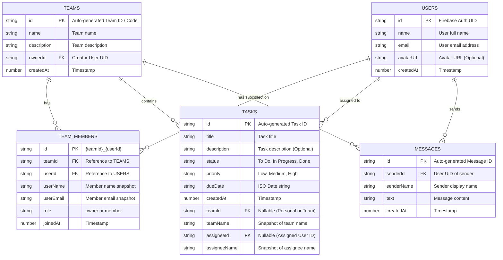

# TaFo - Task Management App (Practical Exam 2)

**TaFo** is a modern, high-aesthetic mobile Task Management application built with **React Native (Expo)**, **TypeScript**, a curated **Warm Orange & Cream Beige Theme** (via React Native Paper), and **Firebase** (Firebase Authentication & Cloud Firestore Real-Time Database).

---

## 🌟 Key Features

### 1. Firebase Authentication
- **Email & Password Authentication**: Full Sign Up and Login flow with real-time error handling.
- **User Profiles**: Stored in Cloud Firestore (`users` collection) synced with Auth state.
- **Session Persistence**: Persistent login session across app reloads via `@react-native-async-storage/async-storage`.
- **Protected Routing**: Unauthenticated users are kept in Auth stack; authenticated users access Home, Teams, Chat, and Profile.

### 2. Real Teams Collaboration
- **Create Teams**: Any user can create a new team with name and description.
- **Join Teams**: Join via unique Team Code / ID or discover public teams.
- **Team Roles & Membership**: Tracks owners and members in `teamMembers` collection.
- **Team Detail Screen**: Overview of team code, member list with contact info, and team-specific task board.

### 3. Tasks Linked to Teams & Assignees
- **Assign to Teams & Members**: Form allows selecting a team and choosing an assignee from the team's member roster.
- **Task Badges**: Tasks clearly display Team and Assignee names.
- **Team-Aware Home Screen**: Home screen aggregates personal tasks and tasks across all teams the user belongs to, with quick filter chips.
- **Full CRUD with Real-Time Sync**: Instant updates using Firestore `onSnapshot`.

### 4. Real-Time Team Chat
- **Dedicated Chat Per Team**: One real-time chat room per team accessible from Team Details.
- **Instant Messaging**: Real-time Firestore subcollection (`teams/{teamId}/messages`) with `onSnapshot`.
- **Modern Chat UI**: Visual distinction between current user (right bubble) and teammates (left bubble with sender name), timestamps, and auto-scrolling.

### 5. Firestore Security Rules
- Production-ready security rules ensuring `request.auth != null` access control across `users`, `teams`, `teamMembers`, `tasks`, and `messages`.

---

## 📊 Database Schema (ERD Diagram)



---

## 🚀 Running the App Locally

1. **Install dependencies**:
   ```bash
   npm install
   ```

2. **Start the Expo development server**:
   ```bash
   npx expo start
   ```

3. **Run on Device or Emulator**:
   - Press `a` for Android Emulator.
   - Press `i` for iOS Simulator.
   - Or scan the QR code with **Expo Go** on a physical device.

---

## 🔒 Firestore Security Rules

See [firestore.rules](file:///firestore.rules) in the project root.
